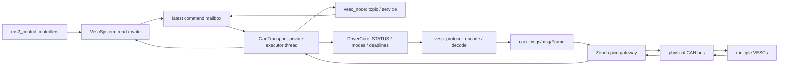

# 構成・スレッド・複数台

## パッケージの分担

| パッケージ | 内容 | 他のパッケージとの関係 |
|---|---|---|
| vesc_can_driver | CAN encode/decode、共通状態・単位変換、通信、通常ノードと指令 msg、模擬 VESC | vesc_msgs を使用。ros2_control への依存なし |
| vesc_can_ros2_control | SystemInterface、control 用 launch、URDF と controller 設定例 | vesc_can_driver の driver / state を使用 |
| vesc_msgs | 上流由来の ROS メッセージ | 両ドライバとは独立したインターフェース定義 |

`vesc_can_driver::protocol` は encode/decode だけの公開 CMake target です。
`vesc_can_driver::driver` はモータ設定・単位変換・状態更新・4 モードの指令処理と
CAN トピック通信をまとめます。`vesc_can_driver::state` は VescState の変換と配信です。
通常ノードと hardware plugin は同じ driver / state をリンクします。
protocol は rclcpp を使わず、driver / state は ROS 通信に rclcpp を使います。
いずれも ros2_control には依存せず、hardware plugin が ros2_control の入口を担当します。
パッケージを分割しても、ライブラリ間の呼び出しにトピック中継や追加スレッドは
発生しません。実行時の CAN executor と mailbox の構成は以下のとおりです。

`DriverCore::receive()` は制御の無効・異常停止中にも状態を更新します。
`ready` / `enable` はドライバのホスト側の制御状態で、CAN 有効化パケットではありません。
パケットの encode/decode は protocol を直接呼び出せます。

通常ノードとプラグインはどちらかを選びます。同じ ID を両方から制御しません。
`vesc_control.launch.py` は controller_manager に hardware component を読み込ませ、
通常ノード `vesc_node` は起動しません
VescSystem は実行ファイルではなく、controller_manager のプロセスへロードする
共有ライブラリです。System 1 つで複数の VESC を管理し、CAN 送受信ノードと
専用 executor スレッドを各 1 つ持ちます。モータごとの ROS ノードやスレッドは
作りません。controller_manager、コントローラ、ROS ミドルウェアのスレッドは別に存在します。

通常ノードは 1 プロセスで、トピック API のノードと CAN I/O の内部ノードの
2 つを持ちます。メイン executor と CAN executor がそれぞれ動きます。
「ROS グラフ上のノードが 1 つ」という構成ではありません。

上位ノード向けの指令入口は `~/commands` の MotorCommands 1 つです
メッセージの names にモータ名、values に各モードの指令値を入れます
状態は `~/motors/<motor_name>/state` から購読します
モータ名と VESC の機器 ID の対応は設定に集約し、上位ノードには CAN ID を要求しません
ros2_control とモータ名を揃えれば、両入口で同じ関節を識別できます

## 制御周期との境界

hardware read/write は、起動時に確保した配列とインターフェースハンドルを使用します。
read は状態のコピー、write は最新指令を共有領域へ渡す処理で、ROS publish や
ネットワーク待機を行いません。共有領域と ros2_control ハンドルのアクセスは
待機しない try-lock 方式です。競合した周期は以前の状態を使う／書き込みを次周期へ
延期します。鮮度期限の検査は続けるため、無期限に古い指令を使い続けません。

CAN executor が一定周期で最新指令を取り出し、変換・制限・異常検査・Frame 送信を
行います。通常ノードでは MotorCommands のモータ名を内部添字に対応付け、指定したモータの
最新指令を受け渡します。hardware では全関節の指令をまとめて受け渡します。
mailbox はモータごとに最新指令だけを保持します。
受信コールバックは同じ executor で STATUS を状態へ反映します。

std::thread は join してから状態を破棄します。自分の executor だけを cancel し、
controller_manager の executor を停止しません。C++ の例外は起動・設定・専用
executor の境界で処理し、デストラクタから例外を出しません。

この方式は soft real-time です。mutex の共有、ROS ミドルウェア、OS スケジューラ、
ネットワークの遅延があるため hard real-time は保証しません。
専用スレッドを追加するだけで制御の決定性が保証されるわけではありません。
重い最適化やスレッドの増設は、実機で周期・CPU・CAN 負荷を測定してから判断します。

## 4 輪独立駆動・操舵の例

1 CAN バスなら System を 1 つ作り、駆動 4 関節 + 操舵 4 関節の計 8 関節を登録します。
同じ CAN Tx/Rx にまとめ、各関節へ固有の controller_id を割り当てます。
別バスの場合は System を分け、Tx/Rx のトピックも分けます。必要なフィードバックを
1 台でも失うと、その System 内の全 VESC を停止します。

8 台へ 100 Hz で送信すると指令は 800 frames/s。STATUS1/4/5 を各 50 Hz で
全台から受信するなら 1200 frames/s、合計 2000 frames/s です。
1 フレーム約 160 bit として余裕を見た概算は 320 kbit/s。
1 Mbit/s CAN の約 32%、500 kbit/s の約 64% に相当します。
これは DLC・bit stuffing・他ノード・再送などで変わる概算で、測定値ではありません。
必要な STATUS と周期を選び、バス負荷を測定してください。

検証は模擬 2 台と 4 モード混在の模擬 4 台での機能確認です。8 台以上での負荷試験、Zenoh pico を含む
途絶・遅延試験、実 VESC での角度・電流・停止の確認は今後の実機導入作業です。

## 外部パッケージとの関係

[sbgisen/vesc](https://github.com/sbgisen/vesc/tree/jazzy-devel) には
ros2_control の ActuatorInterface があり、USB/UART 接続では有用な候補です。
確認した Jazzy ブランチはシリアルポートと VESC パケットを使用します。
本パッケージの native CAN Frame + Zenoh pico 経路へそのまま接続できるものではありません。
通信の置き換え、CAN STATUS の状態取得、複数関節の System 化が必要です。
本実装は同プロジェクトのコードをコピーせず、CAN 境界を共有する構成を採用します。

通常ノードと hardware plugin は、共通の `MotorStatePublisher` でモータごとの
`vesc_msgs/msg/VescStateStamped` を 50 Hz で配信します。1 つの状態タイマーで全台を処理し、
通常ノードではメイン executor、hardware plugin では既存の CAN executor が実行します。
モータごとのノードやスレッドは追加しません。ros2_control の read/write は 100 Hz で
state interface と指令を受け渡し、メッセージの生成・配信は行いません。
関節状態は state interface から取得し、joint_state_broadcaster が `/joint_states` を
50 Hz で配信します
通常ノードの状態出力は VescStateStamped と診断です
[controller_manager の公式仕様](https://control.ros.org/master/doc/ros2_control/controller_manager/doc/userdoc.html#parameters)
でも、manager の update_rate は hardware の read / controller の update / hardware の write の周期です。
CAN 送信は両方の入口で各モータ 100 Hz です。例えば 4 台の指令は合計 400 frames/s になります。
STATUS1〜6 を解釈できる実装でも、
全 STATUS を常時送信する必要はありません。制御に必要な種類と診断用の低頻度データを
VESC Tool 側で選び、CAN と Zenoh の負荷を調整してください。
