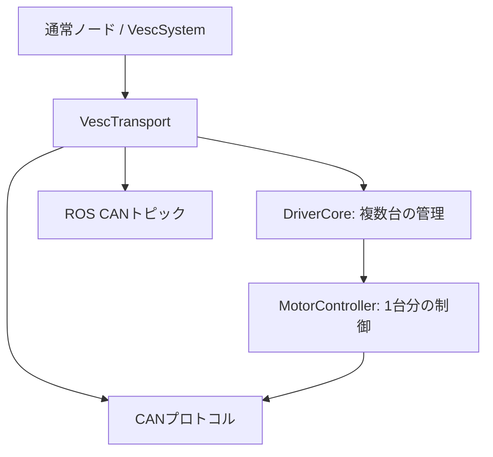

# 内部構成

## ファイルの分担

msgだけを使う上位ノードは `vesc_can_msgs` に依存します
通常ノードとros2_controlは、同じモータ制御と通信管理を使います

| ファイル | 役割 |
|---|---|
| [motor_controller.hpp / cpp](../vesc_can_driver/include/vesc_can_driver/motor_controller.hpp) | 1台分の設定・状態・指令、単位変換、5モード、期限と異常の検査 |
| [driver_core.hpp / cpp](../vesc_can_driver/include/vesc_can_driver/driver_core.hpp) | MotorControllerの一覧を持つラッパー、受信先の振り分け、全台の動作許可・停止 |
| [vesc_transport.hpp / cpp](../vesc_can_driver/include/vesc_can_driver/vesc_transport.hpp) | CAN送受信、周期処理、故障応答の照合、スレッド間の受け渡し |
| [can_protocol.hpp / cpp](../vesc_can_driver/include/vesc_can_driver/can_protocol.hpp) | CANのID・ペイロード形式、フレームの生成とデコード |
| [vesc_node.hpp / cpp](../vesc_can_driver/include/vesc_can_driver/vesc_node.hpp) | 通常ノード、共通の状態・エラー配信 |
| [vesc_system.hpp / cpp](../vesc_can_ros2_control/include/vesc_can_ros2_control/vesc_system.hpp) | ros2_controlのinterfaceとlifecycle |

ヘッダに宣言、cppに実装を置きます
`vesc_main.cpp` は通常ノードを生成してspinする起動入口です
模擬VESCは `test/support/fake_vesc_node.cpp`、設定例は各パッケージの `examples` に置いています

## 所有関係

VescTransportがCANのpublisher・subscriptionとDriverCoreを所有します
DriverCoreは `vector<MotorController>` を持ち、各モータが設定・状態・指令を1組ずつ管理します
CANフレームの生成とデコードはcan_protocolにまとめます

通常ノードとhardware pluginは、それぞれ自分のVescTransportとMotorStatePublisherを所有します
`unique_ptr` は各インスタンスの所有者を表し、ノードの起動数を制限しません
状態配信のクラスは共用し、hardware pluginから通常ノードを起動することはありません

## 指令と受信の流れ

上位ノードの指令値は、モータごとの未送信値として保存します
100 HzのタイマーでDriverCoreが各MotorControllerを呼び、モードに応じたCANフレームを生成します
VescTransportはタイムスタンプを付けてCANトピックへ配信します
内部指令を別の形式へ変換する中継クラスは置きません

受信はcan_protocolで1回デコードし、DriverCoreのID対応表でモータへ振り分けます
対応表は構築時に作成し、受信ごとの全台検索は行いません
未登録IDは状態ロックを取得する前に除外します
単体側で関節単位への変換と各STATUSの受信時刻を更新します
欠測項目はゼロで補わず、未受信・期限切れの値は状態配信時にNaNにします
故障応答はVescTransportで問い合わせ先と受信期限を確認してから反映します

## 単体制御と全台停止

MotorControllerの `command()` は、必須フィードバック、指令期限、モードの制限を検査します
異常時は理由と、そのモータのゼロ電流指令を返して停止を保持します
不正指令や電流起動の失敗も単体で処理し、新しい指令だけで停止を解除しません
`reset_command(now)` は旧指令と停止保持を解除し、初回指令までの期限の起点を設定します
本体故障が残っていれば動作できず、健康な応答と明示的な復旧操作が必要です

DriverCoreは単体の結果をまとめ、1台が異常なら登録された全台を停止します
その周期で既に生成していた動作指令もゼロ電流に置き換えます
全台操作はこのDriverCore内だけが対象で、別ノードや別hardware componentには作用しません
`activate()` はPC側の動作許可です。VESCのCAN有効化パケットは送りません

## 周期処理とros2_control

VescTransportは専用executorを1つ持ち、100 Hzで最新指令を取り出して送ります
通常ノードの `set_commands()` は配列全体を検査し、1回のロックと同じ受信時刻で指定モータを更新します
未送信値は上書きし、未指定モータの指令と期限は維持します
登録台数を超える指令配列は、内部の配列へコピーする前に拒否します
停止要求は自動動作開始より優先し、各フレームの配信直前にも確認します
状態トピックとJointStateは50 Hz、ros2_controlのstate interfaceは100 Hzです

hardwareのread/writeは事前確保した配列をtry-lockで受け渡し、ROS配信や通信待機を行いません
競合時は次周期へ延期し、前回状態にも鮮度判定を適用します
CAN受信・周期送信・故障問い合わせは同じexecutorで実行します
状態ロックは指令と状態の受け渡しに使い、CAN配信や異常通知はロックを解放してから行います
通常ノードの状態配信は親ノードのexecutor、hardware pluginの状態配信はCAN通信のexecutorで実行します
hardware pluginでは状態配信やエラー通知の処理時間もCAN周期に影響します
ROS配信の内部待機、OSのスケジュール、CANブリッジや実バスの待ち時間は、このコードだけでは上限を保証できません
最新値の上書きはドライバ内部の未送信指令が対象で、既にDDSやCANブリッジへ渡したフレームは取り消せません
実機のモータ台数・STATUS周期・ビットレートを使った負荷確認が必要です

## 複数起動と終了

既定トピックは相対名です
namespaceが `/front` なら、`vesc/commands` は `/front/vesc/commands` になります
ノード名だけ変えても指令・状態トピックは共通なので、独立運用ではnamespaceを分けます
CANブリッジを共有するときは同じ絶対CANトピックを指定し、物理CAN IDを重複させません
同じモータを複数のノードから操作しない構成にします

通信スレッドは終了フラグを確認しながら、最大20 msの待機でexecutorを進めます
起動直後に終了を要求しても、最初のタイマーを待ち続けません
終了時は実行中のコールバックを待ってjoinし、停止指令の送信を試みます
状態・エラーのpublisherは通信処理の終了後に破棄します
controller_managerのexecutorは止めず、自分が所有する通信処理だけを終了します
