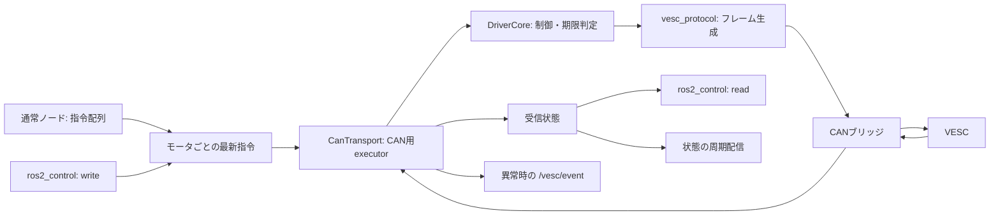

# 内部構成

## フォルダとファイル

3パッケージに分け、msgを使う上位ノードがドライバに依存しない構成にしています
通常ノードとros2_controlは、CAN通信と状態配信の実装を共用します

| フォルダ | 内容 |
|---|---|
| vesc_can_msgs/msg・srv | 指令・状態・エラー・再起動の型 |
| 各パッケージのsrc・include | 実装と公開ヘッダ |
| 各パッケージのlaunch | 起動ファイル |
| 各パッケージのexamples | 基本構成と5モードのYAML・URDF |
| 各パッケージのtest | 単体テストと統合テスト |
| docs | 使い方の詳細と検証記録 |

ドライバの実装は、次の4つを中心にしています

| ファイル | 役割 |
|---|---|
| [vesc_protocol.cpp](../vesc_can_driver/src/vesc_protocol.cpp) | VESCのCAN ID・ペイロード形式、フレームの生成とデコード |
| [vesc_driver.cpp](../vesc_can_driver/src/vesc_driver.cpp) | モータ設定、単位変換、制御判断、CAN通信と周期送信 |
| [vesc_node.cpp](../vesc_can_driver/src/vesc_node.cpp) | 通常ノードの設定、指令配列、再起動サービス、状態配列の配信 |
| [vesc_state.cpp](../vesc_can_driver/src/vesc_state.cpp) | 共通のVescState変換、状態とエラーの配信 |
| [vesc_system.cpp](../vesc_can_ros2_control/src/vesc_system.cpp) | ros2_controlの設定、lifecycle、state / command interface |

公開ヘッダはドライバの `vesc_protocol.hpp`、`vesc_driver.hpp`、`vesc_state.hpp` と、pluginの `vesc_system.hpp` です
`vesc_node` は実行ファイルなので公開ヘッダを持ちません
模擬VESCは `test/support/fake_vesc_node.cpp` に置き、`use_mock` の動作確認にも使うため、BUILD_TESTING=OFFでもインストールします

## 処理の流れ

通常ノードは指令の受信と状態配信をメインexecutorで処理し、CAN用executorを別スレッドで動かします
hardware pluginも内部にCAN I/Oノードと専用executorを1つ持ち、モータごとのスレッドは作りません
通常ノードとhardware pluginは、同じモータに対してどちらかを使います

`DriverCore` は状態更新とモードごとの制御、`CanTransport` は通信と最新指令の受け渡しを担当します
5モードのフレーム生成は `make_frame()` にまとめ、電流・始動・停止の電流フレーム生成を共用します
速度制御と電流始動後の速度制御も、同じ変化率制限とERPM変換を使います

通常ノードの `set_commands()` は配列全体を検査し、1回のロックと同じ受信時刻で指定モータを更新します
未送信の値は上書きし、未指定モータの値と期限は維持します
CAN用executorが100 Hzで最新指令を取り出し、フレーム生成とCANトピックへの配信を順に行います

## 設定と状態

`MotorConfig` は論理 `motor_id` とCANの `controller_id` を別に保持します
論理IDはYAMLまたはURDFの `logical_id` から読み込みます
`MotorState::pos_rad` / `vel_rad_s` は関節単位、`electrical_rpm` / `pid_pos_deg` などはVESCの生値です
局所変数の `cfg` は設定、`opts` は通信設定、`idx` はモータの添字を表します

STATUSと指令の受信時刻は `optional<TimePoint>` で保持し、未受信と時刻ゼロを区別します
期限は単調時刻で判定し、ROSのstampはメッセージに付ける時刻として使います
状態は起動時に確保した配列へコピーし、競合した周期は前回値に鮮度判定を適用します
公開する浮動値は、未受信・期限切れならNaNです

CAN指令は100 Hz、状態トピックは50 Hzです
ros2_controlのstate interfaceは100 Hzで読み取り、JointStateは50 Hzで配信します
位置制御のposition stateはSTATUS4、それ以外はSTATUS5の積算角を使います
内部計算とstate interfaceはdouble、公開msgの監視値はfloat32です

## ros2_controlとの境界

hardwareのread/writeは、事前確保した状態と指令を待機しないtry-lockで受け渡します
競合時は状態の更新や指令の受け渡しを次周期へ延期し、期限の判定は続けます
ROSの配信とネットワーク待機はCAN用executorへ分けています
この構成で実行周期を保証するものではなく、実機の負荷に合わせた確認が必要です

## 停止と終了

`ready()` は必要なSTATUSの鮮度、`activate()` はPC側の動作許可を管理します
CANのencode/decodeやSTATUSの受信だけなら動作許可は不要です
異常時は全台にゼロ電流を送り、停止を保持します
通常ノードはreboot、hardware pluginはlifecycleで復旧します

異常通知は状態ロックの外で `on_fault` を呼び、`MotorStatePublisher` がmotor_idと理由を配信します
本体故障は該当ID、PC側の全台停止は影響する全IDに通知します
hardwareのread/writeは停止を要求し、CAN用executorが通知を処理します

終了時はCAN用executorを停止・joinしてから、状態とpublisherを破棄します
controller_managerのexecutorは止めず、pluginが持つ通信スレッドだけを終了します
