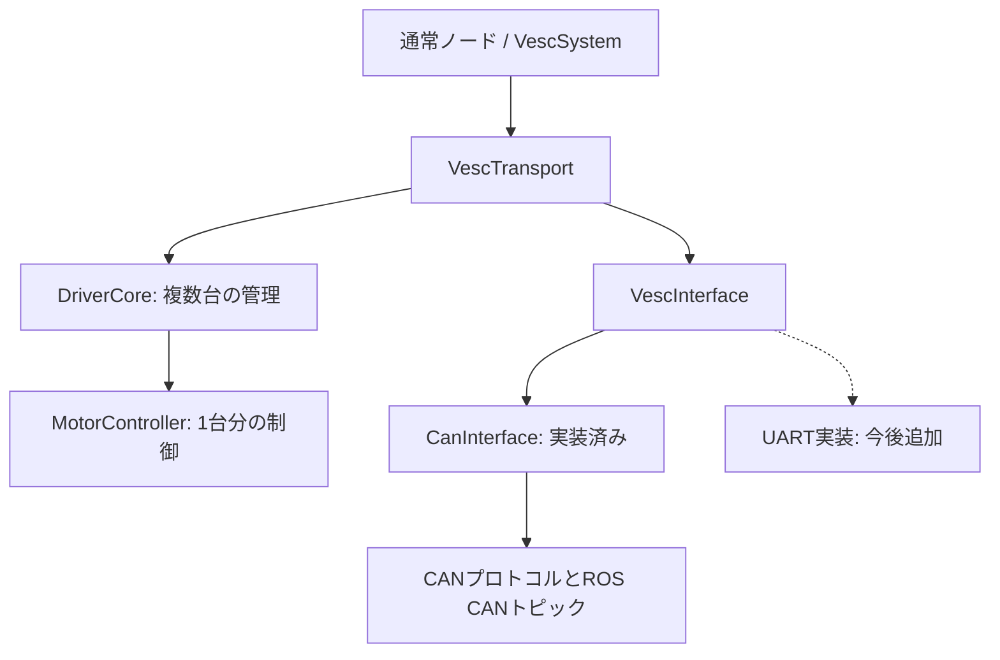

# 内部構成

## ファイルの分担

msgだけを使う上位ノードは `vesc_can_msgs` に依存します
通常ノードとros2_controlは、同じモータ制御と通信管理を使います

| ファイル | 役割 |
|---|---|
| [motor_controller.hpp / cpp](../vesc_can_driver/include/vesc_can_driver/motor_controller.hpp) | 1台分の設定・状態・指令、単位変換、5モード、期限と異常の検査 |
| [driver_core.hpp / cpp](../vesc_can_driver/include/vesc_can_driver/driver_core.hpp) | MotorControllerの一覧を持つラッパー、受信先の振り分け、全台の動作許可・停止 |
| [vesc_interface.hpp](../vesc_can_driver/include/vesc_can_driver/vesc_interface.hpp) | 通信方式に依存しない指令・受信値とVescInterface |
| [vesc_transport.hpp / cpp](../vesc_can_driver/include/vesc_can_driver/vesc_transport.hpp) | VescTransport、周期処理、最新指令、スレッド間の受け渡し |
| [can_interface.hpp / cpp](../vesc_can_driver/include/vesc_can_driver/can_interface.hpp) | VescInterfaceのCAN実装、ROSのCANトピック、故障応答の対応確認 |
| [can_protocol.hpp / cpp](../vesc_can_driver/include/vesc_can_driver/can_protocol.hpp) | CANのID・ペイロード形式、フレームの生成とデコード |
| [vesc_node.hpp / cpp](../vesc_can_driver/include/vesc_can_driver/vesc_node.hpp) | 通常ノード、共通の状態・エラー配信 |
| [vesc_system.hpp / cpp](../vesc_can_ros2_control/include/vesc_can_ros2_control/vesc_system.hpp) | ros2_controlのinterfaceとlifecycle |

ヘッダに宣言、cppに実装を置きます
`vesc_main.cpp` は通常ノードを生成してspinする起動入口です
模擬VESCは `test/support/fake_vesc_node.cpp`、設定例は各パッケージの `examples` に置いています

## 所有関係

VescTransportがDriverCoreと、選択した通信実装を所有します
DriverCoreは `vector<MotorController>` を所有し、各モータが設定・状態・指令を1組ずつ持ちます
CAN実装はモータ一覧を所有せず、共通指令と受信値の変換を担当します
このため、通信方式を交換しても単体・複数台の制御を共用できます

通常ノードとhardware pluginは、それぞれ自分のVescTransportとMotorStatePublisherを所有します
`unique_ptr` は各インスタンスの所有者を表し、ノードの起動数を制限しません
状態配信のクラスは共用し、hardware pluginから通常ノードを起動することはありません

## CANとUARTの境界

MotorControllerはCANフレームを返しません
`VescCommand` に接続先ID、電流・ERPM・PID角度・duty比などの操作と値を入れます
CanInterfaceがCANフレームに変換して送り、受信したCANフレームはデコード済みの `VescFeedback` に戻します
単体制御とDriverCoreは、ROSノードやCANのmsgをincludeせずビルドできます

UARTを追加するときはVescInterfaceを実装し、通常ノードやhardware pluginで生成する通信実装を交換します
差し替えは生成時に行います。UARTでは接続先IDとシリアルポートの対応も通信実装で管理します
現在のYAML・URDFとlaunchはCAN用です。UARTのポート設定や送受信実装はまだ追加していません
UART実装ではCOMMコマンドの生成、長さ・CRC・終端を含むパケット処理、受信値の変換が必要です
CANのフレーム全体をUARTへ流すことはできません → [公式packet.c](https://github.com/vedderb/bldc/blob/94b305ec124b67b0161f2d3d85c4d5b35e48edc5/comm/packet.c)

VescInterfaceの約束は次の通りです

- `configure_targets()`：接続先を登録し、通信方式ごとのIDや接続設定を検査する
- `start()`：受信値とエラーの通知先を設定し、受信処理を始める
- `send()`：共通指令を変換して送る。送信中に受信を通知してもよい
- `stop()`：受信処理を終了し、戻った後は通知しない。独自スレッドがあればjoinする

受信値は、速度・電流・duty、温度・PID角、積算角用カウントなどのブロックで通知します
UARTの応答を分けて通知する場合も、取得できた項目だけを渡し、欠測項目をゼロで補いません
内部の `status1_at` などは対応するブロックの受信時刻です
故障コードは通信実装が応答の妥当性を確認してから通知します
CANでは問い合わせ中の宛先と受信期限を照合し、UART固有の受信処理へCANの照合条件を持ち込みません

## 単体制御と全台停止

MotorControllerの `command()` は、必須フィードバック、指令期限、モードの制限を検査します
異常時は理由と、そのモータのゼロ電流指令を返して停止を保持します
不正指令や電流起動の失敗も単体で処理し、新しい指令だけで停止を解除しません
`reset_command(now)` は旧指令と停止保持を解除し、初回指令までの期限の起点を設定します
本体故障が残っていれば動作できず、健康な応答と明示的な復旧操作が必要です

DriverCoreは単体の結果をまとめ、1台が異常なら登録された全台を停止します
その周期で既に生成していた動作指令もゼロ電流に置き換えます
全台操作はこのDriverCore内だけが対象で、別ノードや別hardware componentには作用しません
`activate()` はPC側の動作許可です。VESCのCAN有効化パケットは送りません

## 周期処理とros2_control

VescTransportは専用executorを1つ持ち、100 Hzで最新指令を取り出して送ります
通常ノードの `set_commands()` は配列全体を検査し、1回のロックと同じ受信時刻で指定モータを更新します
未送信値は上書きし、未指定モータの指令と期限は維持します
状態トピックとJointStateは50 Hz、ros2_controlのstate interfaceは100 Hzです

hardwareのread/writeは事前確保した配列をtry-lockで受け渡し、ROS配信や通信待機を行いません
競合時は次周期へ延期し、前回状態にも鮮度判定を適用します
問い合わせや送信は状態ロックを解放してから通信実装へ渡すため、その場で受信通知されてもロックを待ち合いません
この構成で実行周期を保証するものではなく、実機負荷での確認は必要です

## 複数起動と終了

既定トピックは相対名です
namespaceが `/front` なら、`vesc/commands` は `/front/vesc/commands` になります
ノード名だけ変えても指令・状態トピックは共通なので、独立運用ではnamespaceを分けます
CANブリッジを共有するときは同じ絶対CANトピックを指定し、物理CAN IDを重複させません
同じモータを複数のノードから操作しない構成にします

終了時は周期処理を停止・joinし、停止指令の送信を試みてから通信実装を終了します
通信実装の受信処理も終了してからpublisherを破棄します
controller_managerのexecutorは止めず、自分が所有する通信処理だけを終了します
